# duet

**Claude Code, Codex, Antigravity CLI를 한 팀으로 묶는 로컬 멀티 에이전트 개발 오케스트레이터**

설계자가 요구를 정리하고 구현자·디자이너·리서처에게 작업을 위임한 뒤 결과를 검토함.
설치·로그인된 CLI를 실행하며 구독, 설정, `CLAUDE.md`/`AGENTS.md`, MCP, 스킬, 세션 기억을 유지함. 선택 사항인 JEV 관제는 별도 TypeSafe API 키를 사용함.

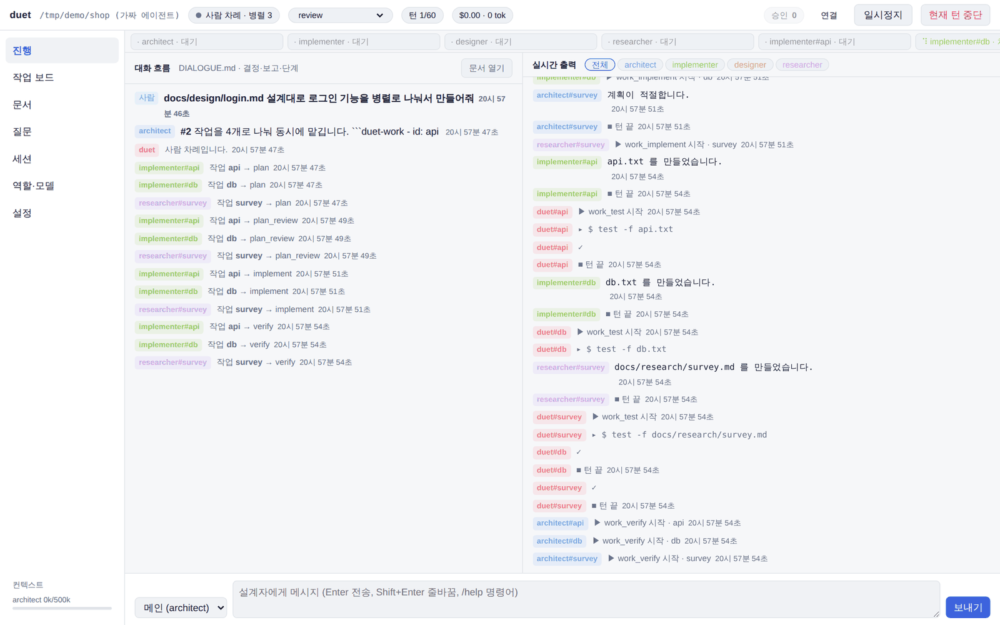

## 목차

- [duet 알아보기](#duet-알아보기)
- [시작하기](#시작하기)
- [협업 방식](#협업-방식)
- [검증과 진행 설정](#검증과-진행-설정) — 검증 수준 · 대화 모드 · 설계 질문 · 승인 · [JEV 관제](#jev-관제)
- [화면 안내](#화면-안내)
- [세션과 운영](#세션과-운영)
- [설정과 명령어 참고](#설정과-명령어-참고)
- [개발과 벤치마크](#개발과-벤치마크)

## duet 알아보기

### 주요 기능

- **CLI 연동**: 설치·로그인된 Claude Code, Codex, Antigravity의 설정·MCP·스킬을 유지함.
- **역할별 협업**: 설계자가 요구를 정리하고 구현자·디자이너·리서처에게 위임함. 독립적인 작업은 워크트리에서 병렬로 진행함.
- **합의 후 구현**: 작업 범위·확인 방법 합의 후 구현. 실제 실행으로 결과 검증.
- **선택 가능한 검증 수준**: 기본은 핵심 기능의 정상 동작만 테스트함. 예외 상황은 미검증 위험으로 보고하고, 필요할 때 균형·전체 검증을 선택함.
- **실행 중 추가 입력**: Ctrl+Enter로 현재 턴에 추가 지시 전달. 설계 질문 모드로 주요 결정에 직접 답변 가능.
- **세션 연속성**: 세션 저장·복원, 컨텍스트 압축, 작업 기억, 선택적 사용량 한도 대기·재개를 제공함.
- **JEV 관제(선택)**: 자동 선택, 승인 심사, 정체 판단과 완료 보고의 인계 판단을 상태에 맞춰 처리함. [설정·동작·평가 방법](docs/jev.md).

- **코딩 컨벤션(선택)**: Markdown 규칙을 등록하고 작업마다 같은 버전으로 구현·검토함. 규칙별 준수 보고와 근거가 없으면 완료 수락을 보류함. [사용 방법](docs/coding-conventions.md).

### 동작 방식

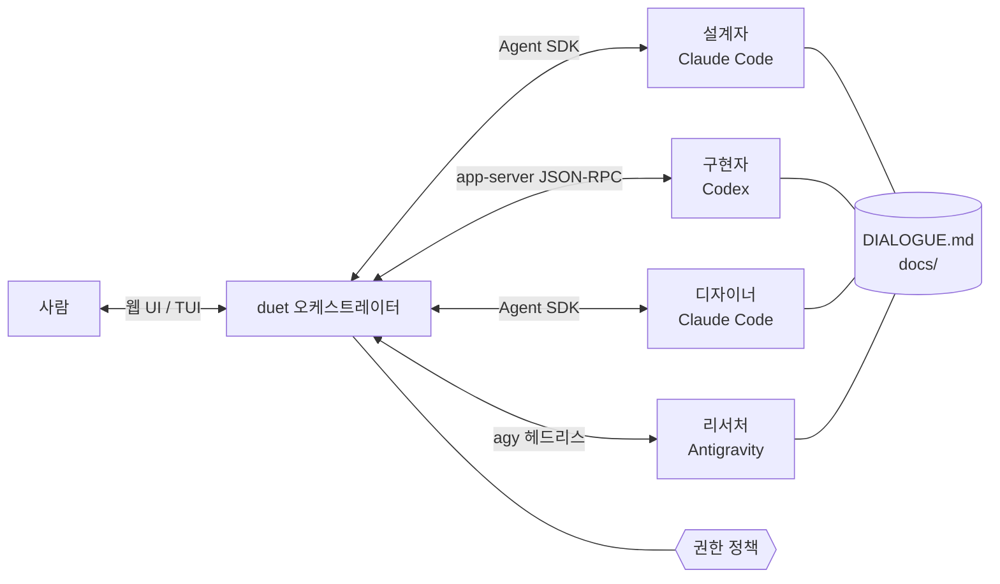

- 에이전트끼리는 프로젝트 루트의 `DIALOGUE.md` 한 문서로 대화함. 긴 설계와 계획은 `docs/` 아래 문서로 남김.
- 턴의 흐름은 응답 끝의 HTML 주석 지시문(`<!-- duet: DELEGATE implementer -->` 등)으로 제어함.
- 도구 호출과 명령 실행에 duet 권한 정책 적용.

## 시작하기

### 요구 사항

| 항목 | 내용 |
| --- | --- |
| 운영체제 | macOS, Linux, Windows (설치 스크립트와 프로세스·UTF-8 처리 지원) |
| Python | 3.10 이상 (없으면 Homebrew Python이나 `uv`를 찾아 사용) |
| git | 턴 스냅샷, 롤백, 병렬 작업에 필요. 병렬 병합은 2.45 이상 권장 |
| CLI | `claude`, `codex`, `agy` 중 쓰려는 것이 설치·로그인 필요 |
| Node.js | 디자이너의 브라우저 도구(Playwright MCP)를 쓸 때 `npx` 필요 |

CLI 설치:

```bash
npm i -g @anthropic-ai/claude-code   # Claude Code
npm i -g @openai/codex               # Codex CLI
# Antigravity CLI(agy)는 https://antigravity.google 안내에 따라 설치 후 agy 로 로그인
```

### 설치와 실행

`duet/` 폴더를 작업할 프로젝트 안에 넣고 프로젝트 폴더에서 실행함.

```bash
cp -r duet ~/my-project/
cd ~/my-project

python3 duet --web    # 브라우저 웹 UI (권장)
python3 duet          # 터미널 분할 화면(TUI)
```

첫 실행 시 자동 준비 항목:

1. `.duet/venv` 가상환경과 의존성(claude-agent-sdk, textual, pyyaml, aiohttp). `requirements.lock`의 고정 버전을 먼저 설치하고 실패하면 `requirements.txt`의 버전 범위로 재시도함. 두 파일의 해시가 바뀌면 다시 설치하며, `uv`가 있으면 우선 사용함.
2. 설치된 CLI를 찾아 `.duet/roles.yaml`을 생성함. 여러 곳에 설치된 CLI는 가장 최신 버전을 선택함.
3. 각 CLI의 로그인 계정을 확인해 구독인지 API 키 과금인지 안내함.
4. `.duet/modes.yaml`, `.duet/policy.yaml`, `DIALOGUE.md`를 생성함.
5. git 저장소가 아니면 `git init`을 하고, `.gitignore`에 duet 폴더와 런타임 파일을 추가함.

`--web`은 이 컴퓨터(127.0.0.1)에서만 열리는 서버를 띄우고, 실행마다 새로 만든 토큰이 붙은 주소를 브라우저에서 엶. 토큰 없는 요청은 거부함. 종료는 터미널에서 `Ctrl+C`임.

#### macOS·Linux 설치 도우미

프로젝트 폴더에서 저장소를 내려받은 뒤 환경을 점검함.

```bash
git clone https://github.com/Choo-Wooo/Duet-AI-Operation.git duet
bash duet/setup.sh --check     # 점검만
bash duet/setup.sh             # 필요한 설치를 항목별로 확인
# bash duet/setup.sh --yes     # 빠진 항목을 묻지 않고 설치
python3 duet --web
```

`install.sh`는 현재 프로젝트에 `duet/`을 클론하거나 기존 Git 설치본을 갱신하고 `setup.sh`를 실행함.
`DUET_DIR`(기본 `duet`), `DUET_REF`(기본 `main`), `DUET_REPO`로 설치 대상을 지정할 수 있음.
`DUET_NO_UV=1`은 uv 설치를 생략하고, `DUET_CHECK=1`은 후속 환경 설치를 생략함. 후자는 클론·코드 갱신 자체를 막지는 않음.
`DUET_FIX=1`은 후속 설치를 자동 수락함.

#### Windows

프로젝트 폴더의 명령 프롬프트에서:

```bat
git clone https://github.com/Choo-Wooo/Duet-AI-Operation.git duet
duet\setup-windows.bat /check
duet\setup-windows.bat
python duet --web
```

`/check`는 점검만, `/yes`는 필요한 항목의 자동 설치임. Python, Git·Git Bash, Node.js, CLI 설치·로그인과 가상환경을 확인함.
Python 런처(`py`) 검색, UTF-8 콘솔, 하위 프로세스 종료, 경로·junction 처리와 데스크톱 알림을 지원함.
Windows에서는 가상환경 Python이 `.duet\venv\Scripts\python.exe`에 있음. macOS·Linux의 `.duet/venv/bin/python` 예제를 이 경로로 바꿔 사용함.

### 첫 작업 시작하기

1. 웹 UI의 **역할·모델**에서 사용할 CLI와 모델을 확인함. 앱이나 CLI를 업데이트했다면 **다시 조회**를 누름.
2. **설정**에서 검증 수준을 선택함. 기본 **핵심 기능 검증**은 정상 동작만 실제로 확인함. 중요한 설계 선택을 직접 답하려면 **설계 질문 모드**도 켬.
3. **진행** 탭의 메인 입력란에 만들거나 고칠 내용을 기재함. 설계자가 요구를 정리하고 작업을 위임함.
4. 진행 중 추가 지시는 **Ctrl+Enter**로 현재 턴에 전달함(macOS는 Cmd+Enter도 가능). 일반 Enter는 보통 전송, Shift+Enter는 줄바꿈임.
5. 완료 보고에서 **핵심 기능과 테스트 결과**, **미검증 예외·위험**을 확인함. 이후에도 이어갈 작업은 세션 화면에서 저장함.

## 협업 방식

### 역할

처음 실행할 때 설치된 CLI에 맞춰 다음 역할을 생성함.

| 역할 | 기본 CLI · 모델 | 권한 | 병렬 최대 | 하는 일 |
| --- | --- | --- | --- | --- |
| architect (메인) | Claude Code · `claude-opus-5-5` | 읽기 전용 (`docs/`, `DIALOGUE.md`만 쓰기) | - | 사람과 대화, 설계, 작업 분할과 위임, 검토, 권한 심사 |
| implementer | Codex · `gpt-6-astra` (effort medium) | 프로젝트 쓰기 | 3 | 합의한 계획대로 구현하고 테스트 통과 |
| designer | Claude Code · `claude-opus-5-5` | 프로젝트 쓰기 | 2 | 화면(UI/UX)·문서·시각 에셋·데이터 시각화 디자인, 렌더링 결과 검증 |
| researcher | Antigravity · `gemini-3.8-flash-medium` | 읽기 전용 (`docs/`만 쓰기) | 2 | 라이브러리·API·선행 사례 조사와 출처가 있는 보고서 |

- 설치되지 않은 CLI의 역할은 다음 선호 CLI로 대체하고, 쓸 수 있는 CLI가 없으면 만들지 않음.
- 이전 버전으로 만든 프로젝트에도 디자이너와 리서처가 없으면 다음 실행 때 한 번 추가함. 이미 있는 프리셋 이름의 역할은 설명·모델을 그대로 두고 역할 도구만 더함. 사람이 지운 역할은 다시 추가하지 않음.
- 그 밖의 역할은 웹 UI의 역할 추가 프리셋(테스터, 코드 리뷰어, 문서 작성자 등)이나 `/role add`로 추가함.
- 역할별 `mcp`(그 역할 세션에만 붙일 MCP 서버)와 `auto_tools`(자동 허용할 도구 이름 패턴)를 `roles.yaml`에서 바꿀 수 있음.
- 설계자가 턴 중에 `PROPOSE_ROLE`로 새 역할을 제안할 수 있으며, 사람이 승인하면 추가됨.

#### 디자이너

디자이너는 사람이 보고 쓰는 모든 것의 형태를 맡음. 설계자는 화면뿐 아니라 문서 구성, 이미지 에셋, 차트가 필요한 작업도 디자이너에게 맡김.

| 분야 | 예 |
| --- | --- |
| 제품 UI/UX | 웹·앱·게임 UI, 화면 흐름, 상호작용, 빈·오류·로딩 상태 |
| 문서 디자인 | README, 설계 문서, 보고서, 가이드, 슬라이드의 구조·제목 위계·표·다이어그램·스크린샷 |
| 시각 에셋 | 색, 타이포그래피, 아이콘, 일러스트, 게임 스킨·텍스처 |
| 데이터 시각화 | 차트 종류, 축·단위·범례, 색 대비 |

공통 작업 절차:

1. **현황 확인**: 기존 스타일(CSS 변수, 테마, 컴포넌트, 에셋 팔레트, 문서 서식)과 `docs/design/`을 읽고 대상과 목적을 정함.
2. **기준 정의**: 디자인 시스템이나 문서 서식 규칙이 없으면 `docs/design/system.md`에 먼저 정하고, 이후 작업은 그 기준을 따름.
3. **방향 비교**: 서로 다른 방향 2~3개를 만들어 비교하고 고른 이유를 남김. 사람의 선택을 기다리지 않고 기준에 비춰 스스로 선택함.
4. **제작**: 기존 컴포넌트·토큰·에셋 규칙을 재사용하고 위계와 여백 리듬을 먼저 잡음.
5. **렌더링 검토**: 결과를 실제로 렌더링한 이미지로 보고 최소 두 번 수정함. UI는 데스크톱·모바일 폭과 라이트·다크·빈·오류 상태를, 문서는 렌더링된 첫 화면과 표·그림을, 에셋은 원래 크기와 확대 미리보기를 확인함. 결과 이미지는 `docs/design/shots/`에 남김.
6. **접근성·가독성**: 대비, 키보드 포커스, 레이블, 문단 길이, 용어 통일을 점검함.

#### 역할별 도구 활용

모든 역할은 자기 CLI가 제공하는 도구 중 역할에 맞는 것을 적극적으로 쓰도록 지침을 받음. 역할에 꼭 필요한 도구는 매번 심사받지 않게 자동 허용함(`auto_tools`).

| 역할 | Claude Code | Codex | Antigravity |
| --- | --- | --- | --- |
| 공통 | 보조 에이전트(Task/Explore), 스킬, MCP, ToolSearch, TodoWrite | apply_patch, MCP, 웹 검색(설정 시), 이미지 보기 | 서브에이전트, manage_task, 파일 검색 도구 |
| designer | `/design` 스킬로 시안 캔버스 생성 후 비교·선택, 디자인·문서 스킬, Playwright 브라우저 스크린샷 (자동 허용) | HTML 목업·헤드리스 브라우저 스크린샷 | 브라우저 도구·스크린샷, `generate_image`로 에셋 시안 (자동 허용) |
| researcher | WebSearch·WebFetch (자동 허용), 보조 에이전트로 병렬 조사 | 웹 검색, 설치된 패키지 소스 확인 | `search_web`·`read_url_content` (자동 허용), 서브에이전트 |
| tester | Playwright로 실제 UI 흐름 확인 (자동 허용) | 테스트 실행 | 브라우저 도구 (자동 허용) |
| reviewer | `/review`, `/security-review` 스킬 결과를 코드로 검증 | 변경 범위 분석 | 코드 검색 |

- Claude Code의 `/design`은 2.1.234 이상에서 쓸 수 있는 스킬로, 기존 코드의 스타일을 읽고 편집 가능한 시안 캔버스를 생성함. 디자이너는 새 화면이나 큰 UI 변경을 이 스킬로 시작하고, 캔버스 링크와 고른 이유를 `docs/design/`에 남김. 스킬을 쓸 수 없으면 HTML 목업 2~3개를 직접 만들어 스크린샷으로 비교함.
- 계획(읽기 전용) 단계에서도 브라우저로 현재 화면을 보는 도구와 검색 도구는 쓸 수 있음. 파일을 만드는 도구(예: `generate_image`)는 합의 뒤에 사용함.

### 합의 기반 위임

review, deliberate, autopilot 모드에서는 작업을 맡기기 전에 계획을 합의함.

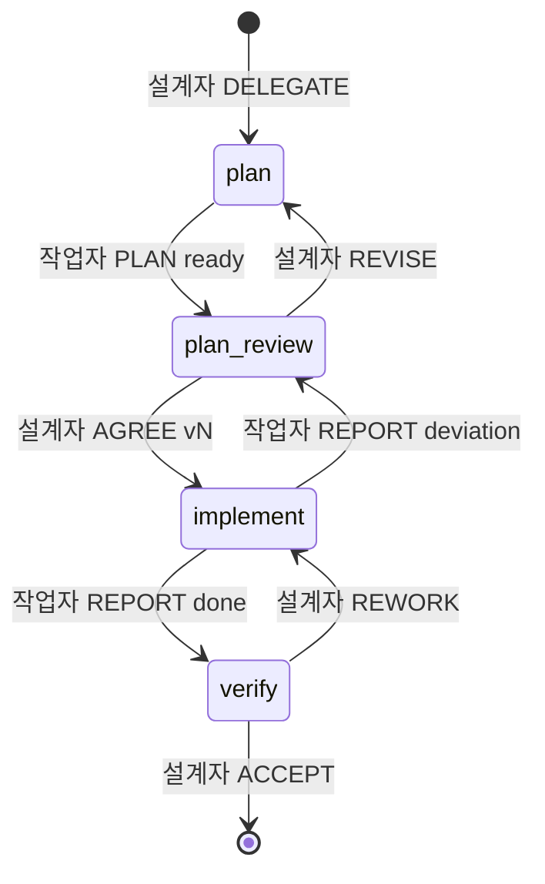

1. **plan**: 작업자는 파일을 읽기만 하고 계획 전문을 제출함. 요구 해석, 설계와 다른 점, `files` 코드블록(바꿀 파일 목록), 수용 기준과 확인 방법, `test_command:` 한 줄, 열린 질문을 포함함. 기본 검증은 핵심 기능·확인 방법 목록만 작성함. 상세한 기준별 테스트 표는 전체 검증에서 작성함. 이 단계에서도 읽기·검색 도구, 보조 에이전트, `ls`·`cat`·`grep`·`git log` 같은 읽기 명령은 쓸 수 있음.
2. **plan_review**: 설계자가 `AGREE vN` 또는 `REVISE 사유`로 답함. 파일 목록과 테스트 명령이 없는 계획은 합의할 수 없음. 라운드 한도(`plan_rounds`, 기본 3)를 넘으면 사람에게 질문함.
3. **implement**: 합의한 계획대로 구현함. 범위를 벗어나야 하면 새 계획과 `REPORT deviation`을 냄.
4. **verify**: 설계자가 합의된 테스트 명령을 직접 실행하고 계획 밖 변경을 검토해 `ACCEPT` 또는 `REWORK 사유`로 판단함.

계획서는 `docs/plans/<task-id>.md`에 버전별로 기록됨. `plan_approval: human`으로 두면 합의 후 사람의 최종 승인을 요청함. 전권 자동이 켜져 있으면 이 승인 선택도 자동 처리됨. 요구·설계 결정을 사용자에게 확인하려면 설계 질문 모드 활성화 필요.

### 병렬 작업

서로 독립적인 일이 여럿이면 설계자가 턴 끝에 `duet-work` 블록을 내어 여러 세션에 동시에 맡김.

````markdown
```duet-work
- id: api-login
  role: implementer
  task: 로그인 API와 테스트를 작성한다. 인터페이스는 docs/design/auth.md를 따른다.
  files: [src/api/login.py, tests/test_login.py]
- id: login-ui
  role: designer
  task: 로그인 화면 시안과 컴포넌트
  depends_on: [api-login]
```
````

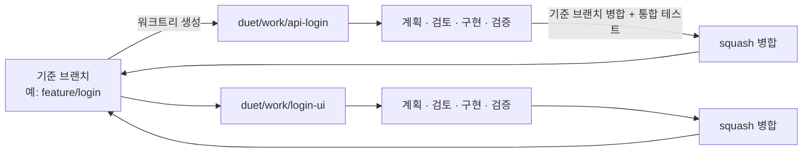

- **세션 수**: 역할별 `max_sessions`와 전체 `max_parallel`(기본 4) 안에서 설계자가 정함. 넘치는 작업은 차례를 기다림.
- **격리**: 작업마다 `.duet/worktrees/<id>` 워크트리와 로컬 전용 브랜치 `duet/work/<id>`를 생성함. 출발점은 duet을 시작할 때 체크아웃돼 있던 브랜치임. 원본의 `node_modules`, `.venv` 같은 의존성 폴더는 링크로 공유함.
- **설계자 분신**: 설계자 세션을 복제한 분신이 작업마다 붙어 계획 검토와 검증을 맡음. 설계자가 여러 세션과 동시에 협의하는 구조임.
- **세션 간 협의**: 작업자는 `CONSULT <작업id|architect> <질문>`으로 다른 작업 세션(읽기 전용 복제본)이나 설계자 분신에게 질문함.
- **병합**: 검증을 통과하면 duet이 작업 브랜치에 기준 브랜치의 최신 내용을 합침. 충돌이 나면 작업자가 해결하고, 통합 테스트를 통과하면 기준 브랜치에 squash 병합한 뒤 워크트리와 작업 브랜치를 삭제함. 병합 커밋 작성자는 git 설정의 사용자 본인임. `auto_merge: false`로 두면 병합 전에 사람에게 질문함.
- **구현 전 테스트**: `work_baseline_test: true`(기본)면 계획 합의 직후 같은 테스트를 먼저 실행해 기존 실패를 기록함. 구현 후에도 실패하면 설계자가 이전 출력과 비교함. 남은 실패가 모두 기존 문제라고 확인한 경우에만 `ACCEPT baseline`으로 예외 수용할 수 있으며, 새 실패를 자동으로 무시하지 않음. 별도의 통합 테스트 명령이 실패하면 병합을 막음.
- **응답 형식 보완**: 병렬 계획·검증에서 첫 유효 줄의 `AGREE`·`REVISE`·`ACCEPT`·`REWORK`도 인식하지만, HTML 주석 지시문 형식이 권장됨. 테스트 명령에 잘못 붙은 백틱도 정리함.
- **push 금지**: duet은 원격에 아무것도 올리지 않음. `duet/work/*` push를 막는 pre-push 훅을 넣으며, 기존 pre-push 훅이 있으면 건드리지 않고 안내함. 작업이 끝나면 사람이 기준 브랜치만 push하면 됨. Bitbucket처럼 브랜치 생성이 제한된 환경에서도 배정받은 브랜치 하나만 쓰게 됨.
- **보고**: 한 차수의 작업이 모두 끝나거나 판단이 필요한 작업만 남으면 결과가 설계자에게 보고됨. 설계자는 `RESUME_WORK <id> [답]`, `CANCEL_WORK <id> <사유>`로 대기 작업을 처리함.
- **기록**: 작업별 대화는 `docs/work/<id>.md`, 상태는 `.duet/work.json`에 남음.

## 검증과 진행 설정

### 코딩 컨벤션

**설정 → 코딩 컨벤션**에서 Markdown을 입력하거나 `.md` 파일을 불러온 뒤 **컨벤션 저장 → 새로 시작하는 작업에 적용**을 켬. 파일은 프로젝트의 `docs/CODING_CONVENTIONS.md`에 저장함(UTF-8 최대 32 KiB).

작업 시작 시 규칙 버전을 고정해 계획·구현·독립 검토에 전달함. 검토자는 규칙별 코드 위치·검사 결과를 보고하며, 보고 누락·버전 불일치·위반·미검증이면 완료 수락을 보류함. 진행 중 문서를 고쳐도 해당 작업의 기준은 바뀌지 않음. 자연어 규칙 자체의 판단은 검토 모델과 실제 검사 도구가 맡음. [설정·보고 형식·작성 예시](docs/coding-conventions.md).

### 검증 수준

**설정 → 검증 수준**에서 선택. 기본값은 **핵심 기능 검증**.

| 수준 | 테스트 범위 | 보고 범위 |
| --- | --- | --- |
| 핵심 기능 검증 (`functional`, 기본) | 핵심 기능의 정상 흐름만 실제 테스트 | 실행 결과 + 미검증 예외·위험 |
| 균형 검증 (`balanced`) | 핵심 기능 + 직접 관련된 회귀·경계·오류 사례 | 실행 결과 + 미확인 범위 |
| 전체 검증 (`thorough`) | 모든 수용 기준, 회귀·통합 및 실행 가능한 전체 테스트 | 기준별 충족 여부 + 테스트 매핑·실행 결과 |

기본 검증 절차:

1. 개발 핵심과 기대 결과를 정함.
2. 기존 테스트나 직접 실행으로 정상 동작을 최소 한 번 확인함. 기존 방법으로 확인할 수 없을 때만 최소한의 기능 테스트를 추가함.
3. 예외·오류·경계·부하·장시간 동작은 테스트를 추가·실행하지 않고, 예상 영향과 추가 검증 후보만 보고함. 실제 결함과 미검증 가능성을 구분함.

기본 수준에서는 전체 테스트·주변 기능 회귀로 범위를 확대하지 않음. 검증용 하네스·시뮬레이터·프레임워크 제작 및 새 의존성 설치를 요구하지 않음. 예외 테스트 미실행만으로 완료를 막지 않음. 전체 수준의 성능·보안·장시간 검증은 관련 위험이 있을 때 포함함.

`/verification functional`, `/verification balanced`, `/verification thorough`로도 변경 가능. 순차·병렬 작업의 다음 턴부터 적용됨. 기존 합의 명령과 명시적 사용자 요구는 유지되며, 합의된 검증 범위를 줄이려면 재합의 필요. 승인 권한과 합의 테스트의 통과 조건은 변경하지 않음.

검증 보고 예시 — 메모 저장 기능:

- **핵심 기능과 테스트 결과**: 저장 후 재조회 시 내용 유지 확인. 정상 저장·조회 통과.
- **미검증 예외·위험**: 저장 공간 부족·쓰기 권한 거부 미검증. 저장 실패 안내 누락 가능성. 필요 시 오류 처리 테스트 추가.

### 대화 모드

| 모드 | 턴 한도 | 합의 흐름 | 특징 |
| --- | --- | --- | --- |
| sprint | 20 | 사용 안 함 | 설계는 짧게, 바로 위임하고 결과 위주로 진행 |
| review | 60 | 사용 | 구현 후 꼼꼼히 검토하고 재작업을 적극 요청 (기본) |
| deliberate | 무제한 | 사용 | 구현 전에 대안·반론·위험을 충분히 논의 |
| autopilot | 무제한 | 사용 | 전권 자동. 설계 질문 모드를 켜면 사용자 설계 결정은 별도로 대기 |

- 턴 한도에 닿으면 10턴 더, 30턴 더, 무제한, 설계자가 정리하고 끝내기, 바로 멈추기 중에서 선택함.
- 무제한일 때도 정체(코드·문서 변경 없음), 핑퐁(변경을 서로 되돌림), 같은 작업 반복을 감지하면 중단 후 사용자에게 확인함.
- 모드는 `.duet/modes.yaml`에서 추가·수정할 수 있음(`max_turns`, `stall_turns`, `agreement`, `autonomy`).

### 설계 질문 모드

자동 승인은 유지하면서 요구·취향·범위·호환성처럼 사람이 정해야 할 선택을 남겨 두는 별도 설정임. 기본값은 **꺼짐**이며, `review`·`sprint`·`autopilot` 등 어떤 대화 모드와도 함께 쓸 수 있음.
설계 질문 모드 자체가 자동 승인을 켜지는 않음. 아래처럼 두 기능을 함께 켜면 사용자 답변 후 일반 작업 자동 진행.

```text
/design-questions on
/autopilot on
```

웹 UI에서는 **설정 → 진행 설정 → 설계 질문 모드**를 켬. 상단 배지에 활성 상태와 보류 질문 수가 표시됨.

1. **초기 계획 질문**: 새 요청의 시작에 아키텍트가 확인할 내용을 모아 선택지·추천안·영향과 함께 질문함. 질문 단계는 읽기·검색만 허용하고 구현·위임은 시작하지 않음. 질문이 없으면 이해한 요구와 계획의 진행 여부를 확인함.
2. **답변을 기준으로 진행**: 진행 탭의 하단 메인 메시지 입력란에서 번호별로 답하면 설계자가 이를 반영해 계획과 작업을 이어감. 자동 승인이 켜져 있으면 일반 도구 승인·운영 선택은 기존 방식대로 처리함.
3. **중요 질문 보류**: 진행 중 새롭게 발견한 중요한 미확정 사항을 `ASK_HUMAN`으로 기록함. 사소한 구현 선택은 에이전트가 판단하고, 중요한 결정에 의존하는 작업은 보류하며 독립적인 작업을 계속함.
4. **사이클 끝에 한 번에 확인**: 진행 가능한 작업이 끝나거나 보류 작업만 남으면 질문을 묶어 표시함. 모든 병렬 작업이 실행을 마칠 때까지 기다리므로 개별 작업마다 사람을 호출하지 않음. 보류 작업을 답변 없이 자동 `RESUME`·`RESUME_WORK`할 수 없음.
5. **답변 후 재개**: 다음 사용자 메시지를 설계자에게 전달해 보류 질문과 함께 검토함. 답하지 않았거나 모호한 항목은 다시 질문하도록 안내함.

여기서 사이클은 사용자 요청에서 시작해 진행 가능한 순차·병렬 작업을 마치는 한 차례임. 개별 도구 호출이나 에이전트 한 턴을 뜻하지 않음.
기존 작업 도중 켜면 진행 중 질문부터 적용하고, 초기 질문은 다음 새 요청에서 진행함. 중요한 질문의 선별·내용은 에이전트가 맡고, 대기·저장·재개 차단은 오케스트레이터가 처리함.

**초기 질문 — 설정 화면에서 질문을 다시 확인한 뒤, 진행 탭의 메인 입력란에서 답변함.**

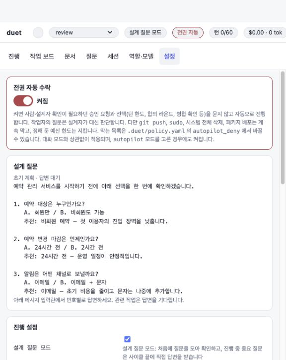

**사이클 마무리 — 역할별로 모인 중요 질문을 한 번에 확인함.**

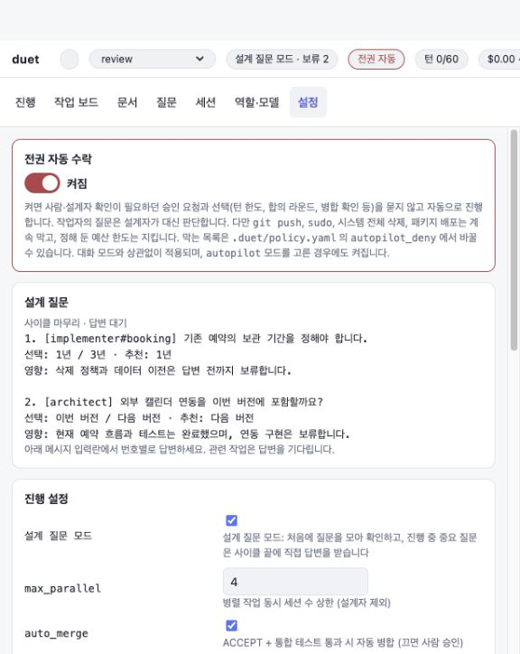

질문과 대기 단계는 `.duet/state.json`에 저장되며 재시작 후에도 유지됨. `/design-questions off`는 기능만 끄고 보류 기록은 지우지 않음.
웹의 **질문 탭**과 `/ask`는 본 작업에서 분리된 읽기 전용 상담 창임. 설계 질문에 대한 답은 질문 탭이 아니라 **메인 대화 입력란**으로 전달함.

### 권한과 안전장치

모든 요청은 세 단계 중 하나로 분류됨.

| 단계 | 대상 예시 | 처리 |
| --- | --- | --- |
| 자동 허용 | 읽기·검색, 프로젝트 안 파일 수정, 테스트·린트·빌드 명령, 역할별 자동 허용 도구 | 바로 실행 |
| 설계자 판단 | 패키지 설치, 목록에 없는 명령, 웹 조회, 알 수 없는 도구 | 설계자의 심사 전용 세션이 허용·거부·사람에게 넘김을 결정 |
| 사람 확인 | `rm -rf`, `git push`, `git reset --hard`, `sudo`, `curl`·`ssh`, `.env`·키 파일, 프로젝트 밖 경로, 해석이 모호한 셸 구문 | 설계자 의견과 함께 승인 요청 |

- 명령은 따옴표와 셸 구문을 해석해 부분 명령마다 검사하며, 읽기 명령에 붙은 쓰기 옵션(`sed -i`, `sort -o` 등)과 파일 리다이렉트도 잡아냄.
- Windows의 PowerShell·cmd 명령도 검사함. 재귀 삭제, 다운로드, 프로세스 종료, 권한 상승·레지스트리 변경 등은 별도 규칙으로 분류함.
- 규칙은 `.duet/policy.yaml`에서 수정함. 판정 기록은 `DIALOGUE.md`에 `> [approval] …`로 남음.
- Claude는 PreToolUse 훅과 권한 콜백으로, Codex는 턴별 샌드박스와 승인 요청으로, agy는 duet 전용 PreToolUse 훅으로 같은 정책을 적용함.

#### 전권 자동 모드

전권 자동은 사람이 모든 권한을 위임한 상태로 끝까지 진행하는 기능임. 두 가지 방법으로 켬.

- **설정의 자동 수락 스위치**: 웹 UI 설정 화면 맨 위의 "전권 자동 수락"을 켜거나 `/autopilot on`을 입력함. 지금 쓰는 대화 모드(review, deliberate 등)는 그대로 두고 승인·선택만 자동으로 처리함.
- **autopilot 모드**: 모드 자체를 `autopilot`(턴 무제한, 스스로 결정하는 진행 방식)으로 바꿈. 웹 UI 상단의 모드 선택, `/mode autopilot`, `--mode autopilot`으로 켬.

활성화 시 동작:

- 사람·설계자 확인이 필요하던 요청도 자동 처리함. JEV 적용 모드에서는 평가 대상 요청을 추가 심사함. `policy.yaml`의 `autopilot_deny`(기본: `git push`, `sudo`, `/`·`~` 통째 삭제, `mkfs`·`dd`, 패키지 배포)는 계속 막음.
- 턴 한도, 합의 라운드, 병합 확인 같은 선택은 기본적으로 진행 쪽을 고르며, JEV 적용 모드에서는 작업 상태에 따라 선택함. 같은 질문이 다섯 번 넘게 반복되면 멈추고, 사람이 정한 예산 한도는 준수함.
- 설계 질문 모드가 꺼져 있으면 순차 작업자의 질문(`ASK_HUMAN`, `REPORT blocked`)은 설계자가 사람 대신 판단함. 설계자 자신의 질문은 사람에게 옴. 병렬 작업의 질문은 해당 작업을 대기 상태로 만들고 설계자에게 보고됨.
- **설계 질문 모드를 켜면** 초기 질문과 진행 중 중요한 질문은 실제 사용자 답변을 기다림. 자동 도구 승인과 설계 결정을 분리하는 기능임.
- 켜져 있는 동안 웹 UI 상단에 "전권 자동" 표시가 나타나며, 누르면 설정 화면으로 이동해 끌 수 있음.

### JEV 관제

JEV는 현재 작업과 최근 턴을 읽고 자동 선택, 승인 요청의 범위·영향, 정체 정황, 완료 보고의 인계를 판단함. 장시간 응답이 없는 세션에는 대기·상태 확인을 권고함. 구현·설계·리뷰는 기존 CLI 모델이 맡음.


1. 웹 **설정 → JEV 오케스트레이션 관제**에서 API 키를 입력하고 **키 저장 → 연결 확인**을 누름.
2. **판단 확신 기준**을 설정함. 기본 `0.8`을 자동 선택·승인·진행·인계에 공통 적용함.
3. **JEV 사용 모드**에서 `관찰` 또는 `적용`을 선택하고, 필요한 판단 기능을 켬.

| 모드 | 동작 |
| --- | --- |
| `off` · 끔 | API 호출 없이 기존 동작 |
| `shadow` · 관찰 | API로 판단을 기록하고 실행은 기존 경로 유지 |
| `on` · 적용 | 기준을 통과한 판단을 실제 흐름에 반영 |

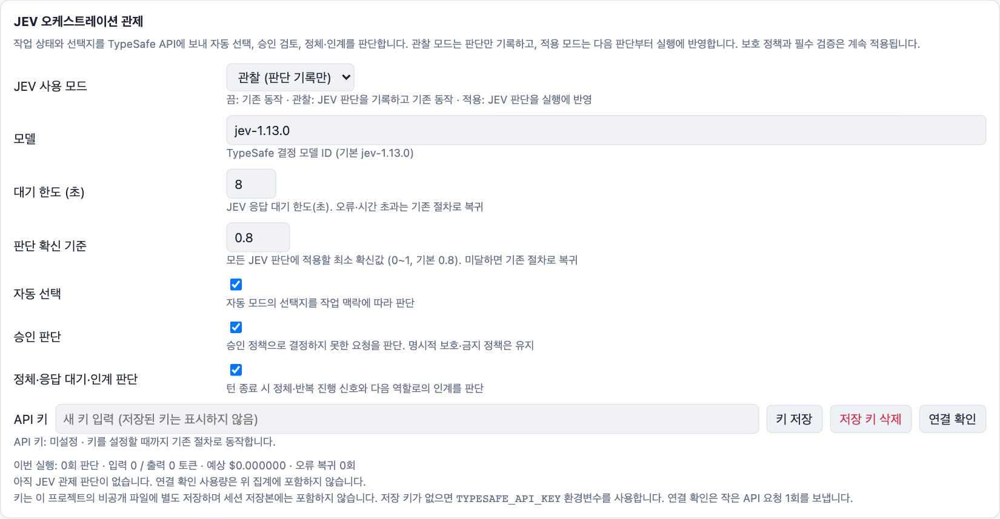

JEV를 켜는 것과 전권 자동은 별개임. `confidence ≥ 0.8`은 판단 적용 기준이며 정확도 80%를 뜻하지 않음. 승인 허용은 작업 범위·영향 두 질문이 모두 기준을 통과하고 **선택지를 역순으로 재확인**해 같은 결과가 나와야 함. 금지 정책, 읽기 전용 단계, 사용자 설계 질문, 예산 한도, 검증·병합 조건은 계속 유지함. 낮은 확신이나 API 오류는 기존 판단 경로로 돌아감.

키는 **작업 프로젝트 루트**의 `.duet/private/jev.json`에 저장함. 예를 들어 `my-project/duet/`에 코드를 설치했다면 키는 `my-project/.duet/private/jev.json`에 있음. 설정 조회·세션 저장본에는 키를 포함하지 않으며 `TYPESAFE_API_KEY` 환경 변수도 지원함.

설정 카드에서 호출 수·토큰·추정 비용을 확인할 수 있고, JEV의 추정 비용은 Duet의 실행 예산에도 합산함. `/jev off|shadow|on`으로 모드 변경 가능. 질문 예시, 판단 이벤트와 실 API 평가 방법은 [JEV 관제 안내](docs/jev.md) 참고.

판단별 질문·선택지·선택한 답·확신값은 **`.duet/logs/jev/DIALOGUE.md` 하나에 대화처럼 이어서 기록**함. 판단 ID로 후속 적용 결과를 연결하며, 기존 개별 기록도 시간순으로 통합함. 웹 **문서** 탭에서는 큰 로그의 최근 부분을 표시하고 전체 기록은 파일에 보존함.

## 화면 안내

### 웹 UI

상단에는 진행 상태, 대화 모드, 턴 수, 비용·토큰, 승인 대기 수, 일시정지·중단 버튼이 있고, 왼쪽 아래에는 역할별 컨텍스트 사용량이 표시됨.

#### 진행

왼쪽은 대화 흐름(사람 메시지, 턴 요약, 지시문, 합의 단계, 승인 기록), 오른쪽은 역할별 실시간 출력(메시지, 도구 호출, 명령 결과)임. 위쪽 활동 줄에서 각 역할과 병렬 작업 세션의 현재 상태를 확인 가능. 아래 입력창에서 받는 대상을 메인, 특정 역할, 병렬 작업 세션 중에서 고를 수 있음.

Enter는 일반 전송, Shift+Enter는 줄바꿈임. Ctrl+Enter(macOS에서는 Cmd+Enter도 가능)는 선택한 대상의 현재 턴에 메시지를 전달함. Codex는 실행 중 추가 입력을 받고, Claude는 도구 처리 사이 또는 응답 마무리 시, agy는 모델 호출 사이에 추가 메시지를 반영함. 대상이 실행 중이 아니거나 반영 전에 턴이 끝나면 다음 턴에 전달하며, 화면에 전달 결과를 표시함.

#### 승인 요청

사람 확인이 필요한 요청은 오른쪽 아래 승인 트레이에 카드로 쌓임. 요청 내용, 사유, 설계자 의견을 보고 허용, 세션 동안 허용, 거부(사유 입력 가능) 중에서 선택함. 여러 요청을 동시에 처리할 수 있음.

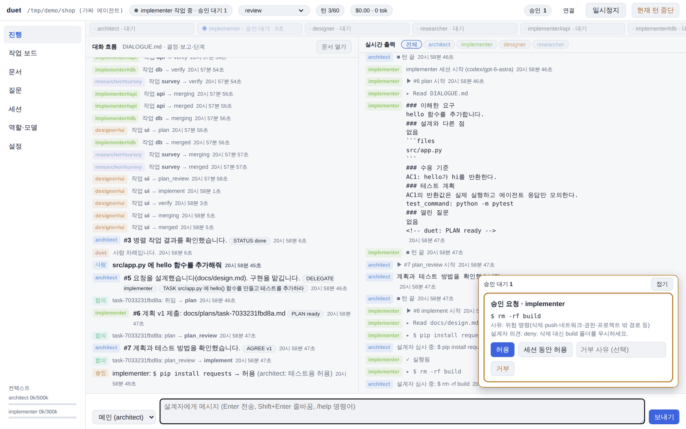

#### 작업 보드

웹 작업 보드는 병렬 작업과 합의 기반 순차 위임을 함께 표시합니다. 순차 위임 카드에는 작업 내용, 담당자, 계획·계획 검토·구현·검증 단계, 대기 사유와 계획 문서가 표시됩니다. 완료·취소된 순차 위임도 보드에 남고 저장 후 재실행해도 유지됩니다. 순차 위임의 재개·취소는 진행 탭에서 메인 담당자에게 요청합니다. 기존 실행에서 이미 끝난 순차 위임 기록은 소급 생성하지 않습니다.

병렬 작업을 대기·진행·완료·중단으로 나눠 표시함. 각 카드에는 역할, 단계(plan, plan_review, implement, verify, merging, merged), 의존 관계, 합의된 파일, 병합 커밋이 표시되고, 작업 기록 보기·재개·취소를 할 수 있음.

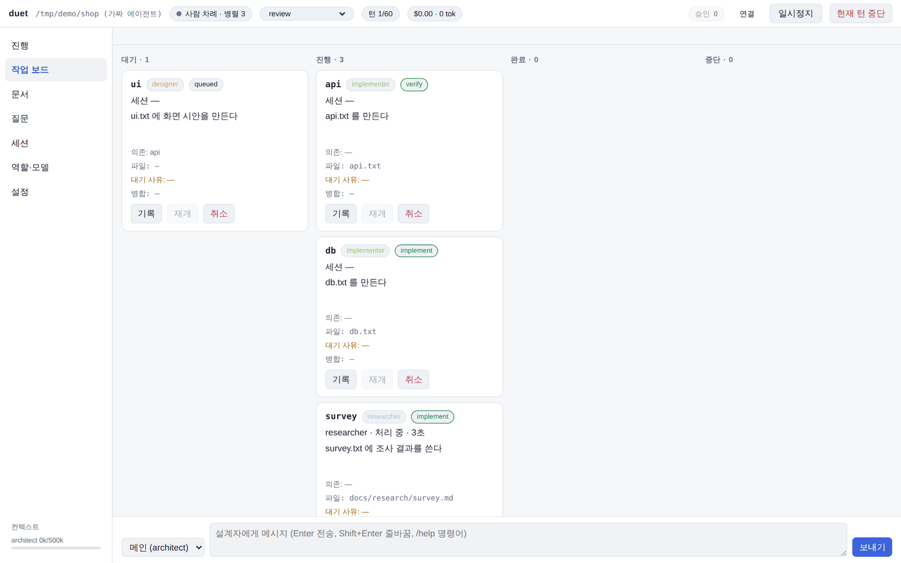

#### 문서

`DIALOGUE.md`, `docs/` 아래 설계·계획·작업 기록·조사 문서를 마크다운으로 렌더링해 표시함.

- 문서는 폴더별 트리로 정리되며, 폴더마다 문서 수가 표시되고 접고 펼칠 수 있음. 처음에는 최상위 폴더만 펼쳐지고, 접힘 상태는 브라우저에 기억됨.
- 맨 위 '최근 수정' 묶음에서 최근에 바뀐 문서 8개를 바로 열 수 있음.
- 경로 필터에 입력하면 맞는 문서와 그 상위 폴더만 펼쳐 보여 주고, '모두 펼치기'·'모두 접기'로 한 번에 정리할 수 있음.
- 목록은 주기적으로 갱신되고, 내용이 바뀐 문서만 다시 그림.

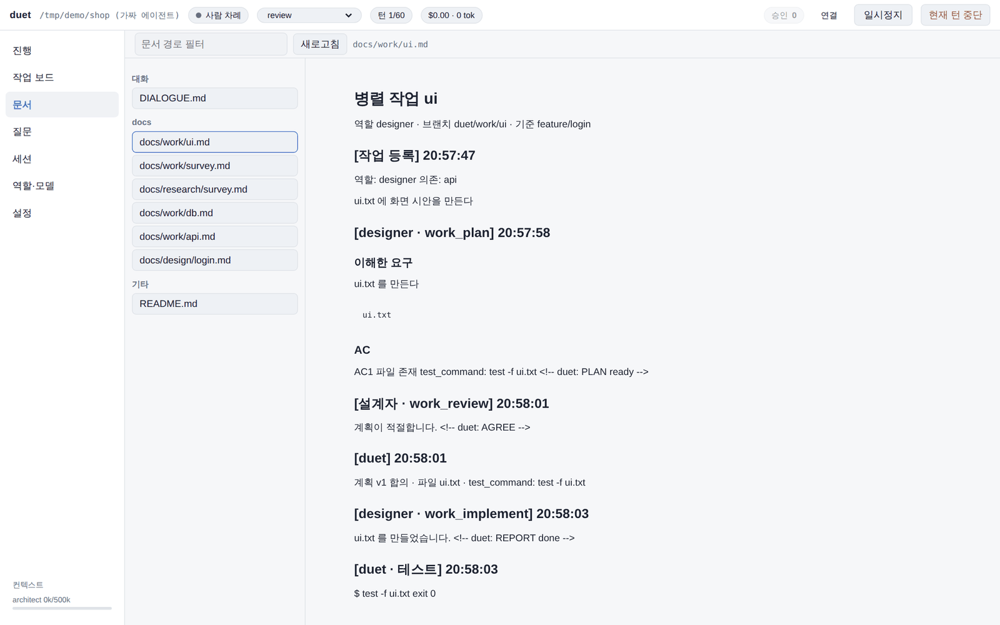

#### 질문

역할 세션을 복제한 읽기 전용 분신에게 프로젝트에 대해 질문함. 본 작업 세션의 기억에는 섞이지 않음.

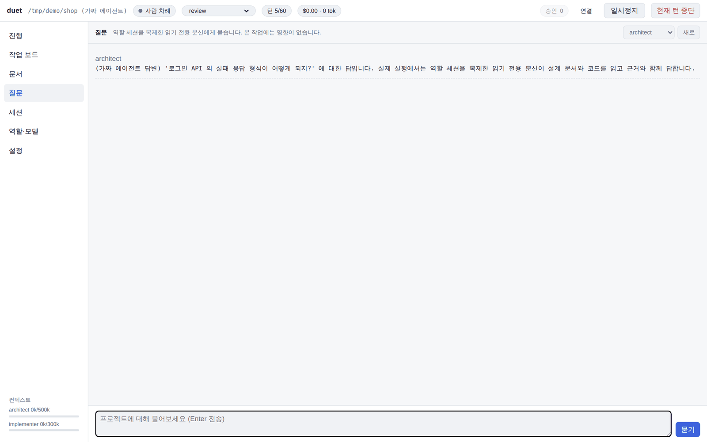

#### 세션

현재 세션에 이름·메모를 붙여 저장함. 저장된 세션의 불러오기·삭제 지원.

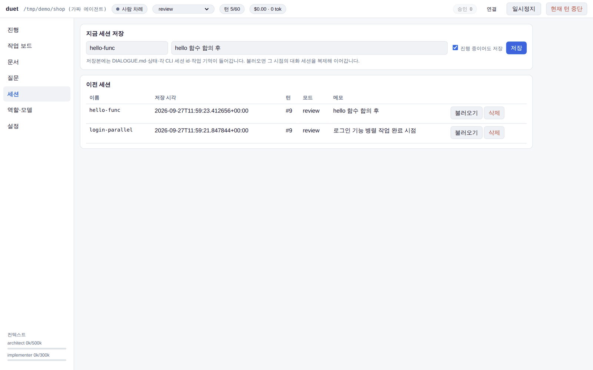

#### 역할·모델

역할의 CLI, 모델, effort, 권한, 병렬 최대 세션 수, 컨텍스트 한도를 바꾸고 역할을 추가·삭제함.

- 모델 선택 칸에는 로그인된 모든 CLI(Claude Code, Codex, Antigravity)에서 조회한 모델이 CLI별로 묶여 나옴. 다른 CLI의 모델을 고르면 그 역할의 CLI도 함께 바뀜.
- macOS에서는 ChatGPT/Codex 앱에 포함된 Codex도 찾아 설치된 CLI 중 가장 최신 버전을 자동으로 선택함. ‘다시 조회’는 CLI 경로도 다시 확인하므로, 앱이나 CLI 업데이트 후 재조회하면 새 버전을 사용함. `DUET_CODEX_PATH`를 지정했다면 해당 경로를 우선함.
- 역할 추가에서 프리셋(디자이너, 리서처, 테스터, 코드 리뷰어, 문서 작성자)을 고르면 역할 설명, 권한, 추천 CLI·모델, 병렬 수, 역할 전용 도구가 자동으로 채워짐.

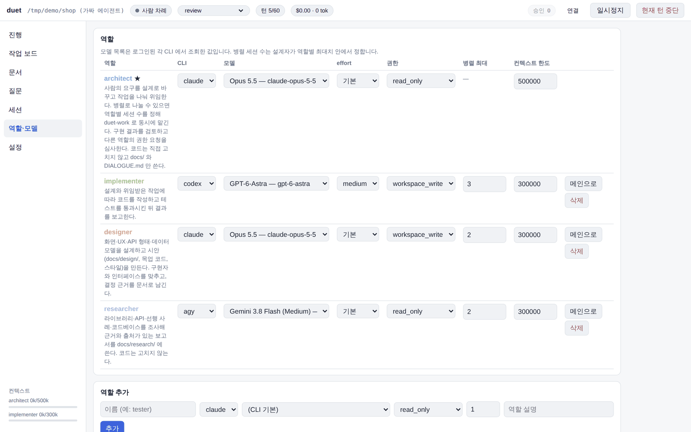

#### 설정

검증 수준을 고르고, 전권 자동 수락과 설계 질문 모드를 각각 켜고 끔. 검증 범위와 보고 방식은 [검증 수준](#검증-수준) 참고. 병렬 동시 실행 수, 자동 병합, 구현 전 테스트, 통합 테스트 명령, 계획 합의 라운드, 압축 시간 제한과 컨텍스트 한도도 바꿈. 설계 질문은 이 화면의 카드에서 다시 확인할 수 있고, 답변은 **진행 탭으로 돌아가 메인 메시지 입력란**에 보냄. 변경 내용은 `.duet/roles.yaml`에 저장됨.

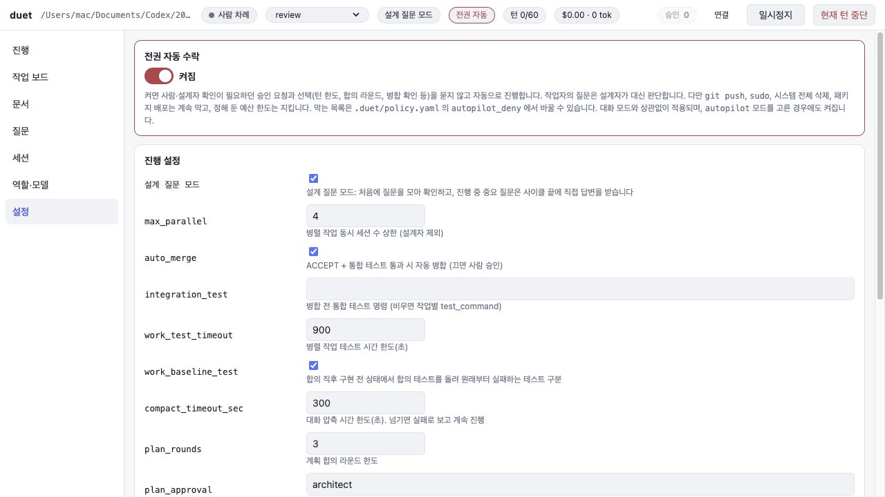

### 터미널 UI

`python3 duet`으로 실행하면 왼쪽에 대화 흐름, 오른쪽에 역할별 탭, 아래에 상태 줄과 입력창이 나옴. 승인 팝업에서 `Y` 허용, `A` 세션 동안 허용, `N` 거부를 선택함. `Ctrl+X` 현재 턴 중단, `Ctrl+Q` 종료, `Esc` 입력창으로 이동함. 단순 콘솔이 필요하면 `--no-tui`를 사용함.

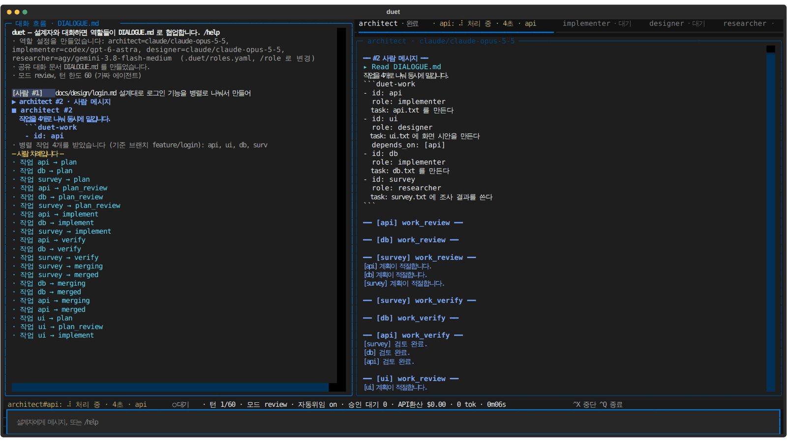

## 세션과 운영

### 세션 저장과 불러오기

- `/save 이름 -- 메모`로 저장하고 `/load 이름`으로 돌아옴. 웹 UI 세션 화면에서도 저장·불러오기 가능.
- 저장본에는 `DIALOGUE.md`, 진행 상태, 역할 설정, 각 CLI의 세션 ID가 들어감. 불러오면 그 시점의 CLI 세션을 복제해 이어가므로 원래 세션은 그대로 남음.
- 불러오기 전 현재 상태는 `_autosave-*`로 자동 저장되며 최근 5개를 유지함.
- 코드는 되돌리지 않음. 코드를 되돌리려면 `/rollback <턴번호>`로 그 턴의 git 스냅샷으로 돌아감.
- 재시작하면서 복원하려면 `python3 duet --load 이름`, 목록만 보려면 `python3 duet --list-saves`를 사용함.

### 긴 세션 관리

| 장치 | 설명 |
| --- | --- |
| 컨텍스트 한도 | 역할별 `context_limit`(설계자 50만, 작업자 30만 토큰, 기본 10만)을 넘으면 다음 턴 전에 압축 |
| 압축 시간 제한 | `compact_timeout_sec`(기본 300초) 내에 끝나지 않으면 실패로 처리하고 후속 복구 흐름으로 진행 |
| 역할별 압축 지침 | 설계 결정·합의 계획·바꾼 파일 등 역할마다 보존할 내용을 지정해 CLI 고유 압축을 실행 |
| 작업 기억 | 에이전트가 매 턴 목표·결정·파일 지도를 요약하고, duet이 `.duet/memory/<역할>.md`에 저장 |
| 세션 교체 | 압축으로 부족하거나 입력 한도 오류가 나면 새 세션으로 바꾸고 작업 기억으로 인계 |
| 프롬프트 가드 | 한 턴 입력이 `prompt_max_chars`를 넘으면 초과분을 `.duet/reports/`로 빼고 경로만 전달 |
| 체크포인트 | 일정 턴마다 또는 `DIALOGUE.md`가 커지면 설계자가 요약하고 이전 대화를 `DIALOGUE-archive/`로 이동 |

#### 사용량 한도 자동 대기·재개 (선택)

5시간 사용량 한도 등으로 CLI가 거절한 작업을 기다렸다가 이어가는 옵션임. **기본값은 꺼짐**이며, 자동 승인·설계 질문 모드와 독립적으로 켜고 끔.

```text
/usage-retry on
/usage-retry off
```

웹 **설정 → 사용량 한도 자동 대기·재개**에서도 켤 수 있음.

- CLI가 명시적인 사용량·요청 한도 오류를 반환했을 때만 적용함. 정상 답변에 등장하는 ‘한도’라는 단어, 인증·결제 오류, 컨텍스트 초과나 사용자 중단을 자동 재시도하지 않음.
- CLI가 제공한 재설정 시각·재시도 간격을 우선 사용함. 알려진 미래 재설정 시각에는 5초 여유를 두고, 시각이 없거나 이미 지났으면 `usage_limit_wait_sec`만큼 기다림(기본 18000초 = 5시간). 실제 한도가 항상 5시간에 풀린다고 가정하지 않음.
- 본 작업, 병렬 작업 및 승인 심사 턴에 적용함. 같은 CLI를 사용하는 다른 턴도 관측된 대기 시간을 공유하고, 다른 CLI는 독립적으로 진행할 수 있음.
- 대기 후 연결을 다시 열되 기존 세션·스레드 ID를 유지함. 이미 끝난 변경을 확인하고 미완료 부분만 이어가도록 안내함. 외부 도구 실행의 중복을 완전히 보장하는 트랜잭션 기능은 아님.
- 웹 진행 화면에 역할·재시도 시각을 표시함. `/pause` 상태에서는 시각이 지나도 재시도하지 않으며, `/resume` 후 이어감. `/stop` 또는 옵션 끄기는 현재 대기를 취소함. 정해 둔 비용·시간 한도도 준수함.
- 한 턴에서 최대 `usage_limit_max_retries`회(기본 3회) 재시도하고, 계속 제한되면 오류를 보고함. 로그인 상태나 계정을 바꾸거나 한도를 우회하지 않음.
- **duet 프로세스가 실행 중이어야 함.** 앱·터미널을 종료하면 대기 실행도 끝나며, 재시작 시 예약을 자동 복원하지 않음. 컴퓨터가 잠든 동안에는 작업이 실행되지 않고 깨어난 뒤 시각을 확인함. 별도 읽기 전용 `/ask` 콘솔에는 이 자동 대기가 적용되지 않음.

### 세션과 문서를 보존하는 업데이트

코드는 프로젝트의 `duet/`에, 사용자 세션과 문서는 그 옆에 저장됨.

| 경로 | 업데이트 때 처리 |
| --- | --- |
| `duet/` | 코드·의존성·설치 스크립트 갱신 |
| `.duet/` | 세션 ID, 설정, 저장본, 작업 기억·작업 상태 보존 |
| `DIALOGUE.md`, `DIALOGUE-archive/` | 대화와 과거 기록 보존 |
| 프로젝트의 `docs/` 및 기타 문서 | 설계·계획·작업 기록 보존 |

진행 중 작업을 정리하고 duet을 종료한 뒤, `duet/`을 별도로 클론한 설치라면 다음과 같이 갱신함.

```bash
git -C duet status --short
# 로컬 변경이 없음을 확인한 뒤 실행
git -C duet pull --ff-only
python3 duet --web
```

직접 복사한 설치본은 대상 코드의 로컬 수정부터 백업·비교하고 코드 파일만 반영함. 대상의 `.git`을 원본 것으로 덮어쓰거나, 프로젝트 루트 전체를 삭제·동기화하지 않음.
`duet/docs/`는 제품 문서와 이미지이고 프로젝트의 `docs/`는 작업 문서임. 두 경로 구분 필요.
기존 세션을 이어갈 때는 `--new-session`을 사용하지 않음. 의존성 변경에 따른 가상환경 갱신은 다음 실행 때 자동 처리됨.

### 환경 점검과 복구

```bash
python3 duet --doctor                  # 진단과 해결 안내
python3 duet --doctor --no-login       # CLI 로그인 상태 조회 생략
python3 duet --doctor --fix            # 수정 가능한 항목을 확인 후 처리
python3 duet --doctor --fix --yes      # 수정 작업을 자동 수락
```

`--doctor`는 가상환경을 만들기 전에 표준 라이브러리만으로 실행함. 운영체제, Python·uv, Git, Node.js, CLI 경로·버전·로그인, 역할 설정, 가상환경과 네트워크를 점검함. PATH 밖에 설치된 CLI도 찾아 해결 방법을 표시함.
수정 후에는 새 터미널에서 다시 점검 필요. `--fix` 실행의 종료 코드는 수정 전 진단 결과를 기준으로 하므로 재점검 결과를 확인해야 함.
`--no-login`은 로그인 확인만 생략하며 네트워크 점검을 끄는 옵션은 아님.

### 문제 해결

| 증상 | 확인 사항 |
| --- | --- |
| 검증 범위가 너무 큼 | **설정 → 검증 수준 → 핵심 기능 검증** 선택. 이미 합의한 테스트의 범위 축소는 재합의 필요. |
| 설계 질문이 자동 처리됨 | **설계 질문 모드** 활성화 후 메인 입력란으로 답변. `/ask`는 별도 상담. 초기 질문은 새 요청부터 적용됨. |
| 답변 후에도 작업 보류 | 질문 번호와 선택을 명확히 답했는지 확인. 메인이 답변 반영 후 재개함. |
| 설치·가상환경 문제 | `python3 duet --doctor`, `setup.sh --check` 또는 `setup-windows.bat /check`로 진단. |
| Windows 한글·CLI 실행 문제 | 새 터미널에서 재실행. Python·Git Bash·CLI 경로 확인. |
| 압축 지연 | `compact_timeout_sec` 확인. 기본 제한 300초. |
| 기존 테스트 실패로 작업 중단 | 구현 전 테스트와 검증 출력 비교. 설계자의 기존 실패 확인 필요. |
| `unrecognized arguments: --web` | 프로젝트의 `duet/`을 최신 코드로 갱신. |
| Claude API 오류(버전 미지원) | 시작 안내의 CLI 경로·버전 확인. PATH에 오래된 설치본이 있는지 확인. |
| 예상보다 큰 비용 | 시작 안내의 계정 표시에서 구독·API 키 과금 여부 확인. |
| 병렬 작업 시작 안 됨 | git 커밋 1개 이상, 브랜치에 연결된 HEAD, `git_snapshots` 활성화 필요. detached HEAD는 지원하지 않음. |
| 병합 대기 | 기준 브랜치와 미커밋 변경 확인. 작업 보드의 대기 사유 참고. |
| 디자이너 브라우저 도구 실행 안 됨 | `npx` 설치 확인. 첫 실행 시 패키지 다운로드 시간 소요. |
| agy 권한 경고 | 시작 경고와 `.agents/hooks.json`의 duet 훅 확인. |
| 상세 상태 확인 | `.duet/logs/<날짜>.jsonl`의 이벤트 기록 참고. |

## 설정과 명령어 참고

### 명령어

웹 UI 입력창과 TUI 입력창에서 같은 명령을 사용함. 일반 텍스트는 설계자에게 전달됨.

| 명령 | 동작 |
| --- | --- |
| `/to <역할> <메시지>` | 특정 역할에게 직접 전달 |
| `/verification [functional\|balanced\|thorough]` | 검증 수준 보기·변경 (기본: 핵심 기능 검증) |
| `/mode [이름]` | 대화 모드 보기·변경 |
| `/turns <N\|inf>` | 이번 요청의 턴 한도 |
| `/auto on\|off` | off면 위임 전마다 확인 |
| `/autopilot on\|off` | 전권 자동 수락 켜기·끄기 |
| `/jev [off\|shadow\|on]` | JEV 관제 끄기·관찰·적용, 인자 없으면 상태 보기 (키는 웹 설정) |
| `/usage-retry [on\|off]` | 사용량 한도 자동 대기·재개 켜기·끄기, 상태 보기 |
| `/design-questions [on\|off]` | 설계 질문 모드 켜기·끄기, 인자 없으면 상태와 보류 수 보기 |
| `/role list` | 역할 목록 |
| `/role add <이름> <claude\|codex\|agy> <모델> <설명>` | 역할 추가 |
| `/role edit <이름> <항목>=<값>` | cli, model, brief, permissions, effort, context_limit, max_sessions 변경 |
| `/role remove <이름>` | 역할 삭제 |
| `/work` | 병렬 작업 보드 보기 |
| `/work cancel <id> [사유]`, `/work resume <id>` | 병렬 작업 취소·재개 |
| `/work msg <id> <메시지>` | 병렬 작업 세션에 메시지 (다음 턴에 전달) |
| `/ask [역할]` | 새 터미널 창에 읽기 전용 질문 콘솔 열기 |
| `/memory [역할]` | 역할의 작업 기억 보기 |
| `/compact [역할]` | 다음 턴 전에 그 역할의 대화 압축 |
| `/pause`, `/resume`, `/stop` | 자동 진행 멈춤, 재개, 현재 턴 중단 |
| `/rollback <턴번호>` | 그 턴의 git 스냅샷으로 되돌리기 |
| `/save [이름] [--force] [-- 메모]` | 세션 저장 |
| `/saves`, `/load <이름>`, `/save-delete <이름>` | 저장본 목록, 불러오기, 삭제 |
| `/status`, `/plan`, `/help`, `/quit` | 상태, 현재 합의 계획, 도움말, 종료 |

### 명령행 옵션

| 옵션 | 설명 |
| --- | --- |
| `--web` | 브라우저 웹 UI로 실행 |
| `--port <번호>` | 웹 UI 포트 (기본 8765, 사용 중이면 다음 번호) |
| `--host <주소>` | 웹 UI 주소 (기본 127.0.0.1) |
| `--no-browser` | 브라우저를 자동으로 열지 않음 |
| `--no-tui` | 단순 콘솔 모드 |
| `--mode <이름>` | 시작 모드 |
| `--max-turns <N\|inf>` | 요청당 턴 한도 |
| `--budget-usd <금액>`, `--max-hours <시간>` | 비용·시간 한도 (선택) |
| `-m "<메시지>"`, `--message "<메시지>"` | 시작하자마자 설계자에게 보낼 메시지 |
| `--new-session` | 저장된 에이전트 세션을 버리고 새로 시작 |
| `--load <이름>`, `--list-saves` | 저장본 불러오기, 목록 출력 |
| `--ask [역할]` | 질문 콘솔만 실행 |
| `--fake` | CLI 연결 없이 작업 흐름 시뮬레이션 |
| `--no-venv` | 가상환경 자동 준비를 건너뜀 |
| `--doctor` | 환경 진단 후 종료 |
| `--fix`, `--yes` (`-y`), `--no-login` | `--doctor`의 수정·자동 수락·로그인 조회 생략 옵션 |
| `--bench` | 무인 벤치마크 실행 |
| `--bench-task <파일>` | 과제 설명 파일 (`-m`보다 우선) |
| `--bench-out <파일>` | 결과 JSON 경로 (기본 `.duet/bench-result.json`) |
| `--bench-parallel <N>` | 병렬 작업 수 (1이면 병렬 없이 진행하도록 안내) |
| `--bench-timeout <초>` | 전체 제한 시간 (기본 10200초) |
| `--bench-nudges <N>` | 사람 차례에서 자동 재촉하는 최대 횟수 (기본 3) |
| `--role-model <역할=cli/모델>` | 역할별 CLI·모델 지정. 여러 번 사용 가능 |

### 설정 파일

```text
duet/                      이 도구 (프로젝트에 복사)
.duet/roles.yaml           역할과 진행 설정 (main, roles, settings)
.duet/modes.yaml           대화 모드 프리셋
.duet/policy.yaml          권한 정책 (auto_commands, human_commands, protected_paths, autopilot_deny)
.duet/state.json           세션 ID, 턴 번호, 현재 모드, 진행 중 작업·설계 질문 (자동 관리)
.duet/work.json            병렬 작업 상태 (자동 관리)
.duet/models.json          CLI별 모델 목록 캐시
.duet/private/jev.json     JEV API 키 (비공개, 저장본 제외)
.duet/web.json             로컬 웹 접속 주소·프로세스 정보
.duet/bench-result.json    벤치마크 결과 지표
.duet/reports/             긴 프롬프트·변경 목록 등 보조 기록
.duet/asks/                읽기 전용 질문 콘솔 기록
.duet/memory/<역할>.md      역할별 작업 기억
.duet/saves/<이름>/         저장한 세션
.duet/logs/*.jsonl         전체 이벤트 로그
.duet/logs/jev/DIALOGUE.md JEV 질문·선택지·답변·적용 결과 누적 기록
.duet/worktrees/<id>/      병렬 작업 워크트리 (병합 후 삭제)
DIALOGUE.md                에이전트 공유 대화 문서
docs/plans/, docs/work/    합의 계획서, 병렬 작업 기록
```

주요 `settings` 항목(`.duet/roles.yaml`). `ask_compact_tokens`를 제외한 아래 항목은 웹 UI에서도 변경 가능.

| 항목 | 기본값 | 설명 |
| --- | --- | --- |
| `verification_level` | functional | 핵심 기능 검증. `balanced`, `thorough`로 범위 확대 |
| `usage_limit_retry` | false | 사용량 한도에 걸린 턴을 대기 후 재시도 |
| `usage_limit_wait_sec` | 18000 | 재설정 시각이 없을 때 대기할 초(60~604800) |
| `usage_limit_max_retries` | 3 | 한 턴의 한도 오류 재시도 횟수(1~100) |
| `full_auto` | false | 대화 모드와 별개로 일반 승인·선택 자동 처리 |
| `design_questions` | false | 초기 질문과 사이클 끝 중요 질문에 사용자 답변 대기 |
| `jev_mode` | off | JEV 관제: `off` 기존 동작, `shadow` 관찰, `on` 판단 적용 |
| `jev_model` | jev-1.13.0 | TypeSafe의 JEV 모델 ID |
| `jev_timeout_sec` | 8 | JEV 요청 시간 한도(1~60초, 재시도 포함) |
| `jev_confidence_threshold` | 0.8 | 선택·승인·진행·인계에 공통 적용하는 confidence 기준 |
| `jev_choices` | true | 전권 자동의 선택 판단 |
| `jev_approvals` | true | 정책이 허용하는 범위의 승인 심사 |
| `jev_flow` | true | 정체·장시간 응답 대기·완료 보고 인계 판단 |
| `max_parallel` | 4 | 병렬 작업 동시 세션 수 상한 |
| `auto_merge` | true | 검증과 통합 테스트 통과 시 자동 병합 |
| `integration_test` | 없음 | 병합 전 통합 테스트 명령 (없으면 작업별 test_command) |
| `work_test_timeout` | 900 | 병렬 작업 테스트 시간 한도(초) |
| `work_baseline_test` | true | 구현 전 테스트 결과로 기존 실패 구분 |
| `compact_timeout_sec` | 300 | 대화 압축 시간 한도(초) |
| `ask_compact_tokens` | 200000 | 읽기 전용 질문 콘솔 압축 기준 |
| `plan_rounds` | 3 | 계획 합의 라운드 한도 |
| `plan_approval` | architect | `human`이면 합의 후 사람 최종 승인 |
| `context_limit_tokens` | 100000 | 역할 기본 컨텍스트 한도 |
| `compact_floor_tokens` | 40000 | 작업 경계에서 미리 압축하는 기준 |
| `prompt_max_chars` | 20000 | 한 턴 프롬프트 최대 글자 수 |
| `dialogue_max_kb` | 120 | `DIALOGUE.md` 보관 기준 |
| `checkpoint_every` | 50 | 체크포인트 간격(턴, 0이면 끔) |
| `git_snapshots` | true | 턴마다 git 스냅샷 커밋 |

#### 환경 변수

| 변수 | 용도 |
| --- | --- |
| `DUET_CLAUDE_PATH`, `DUET_CODEX_PATH`, `DUET_AGY_PATH` | 자동 검색 대신 사용할 CLI 실행 파일 경로 |
| `TYPESAFE_API_KEY` | 저장된 프로젝트 키가 없을 때 사용할 JEV API 키 |
| `DUET_USE_PIP=1` | 의존성 설치 때 가능한 경우 uv 대신 pip 선택 |
| `DUET_NO_VENV=1` | 가상환경 준비 생략 (`--no-venv`와 동일) |
| `DUET_NO_NOTIFY=1` | 브라우저 연결이 없을 때 데스크톱 알림 생략 |
| `DUET_CODEX_SANDBOX=off` | 격리된 벤치 컨테이너 등에서 Codex 자체 샌드박스 해제 |
| `DUET_BENCH_KEEP_MCP=1` | 벤치마크에서 역할 MCP 설정 유지 |

### CLI별 참고 사항

#### Claude Code

- Claude Agent SDK로 설치된 `claude`를 실행함. 사용자·프로젝트 설정(`~/.claude`, `CLAUDE.md`, MCP, 스킬)을 그대로 불러옴.
- 상단의 비용은 API 요금 환산값임. 구독으로 로그인했다면 실제 청구가 아님. 시작할 때 `ANTHROPIC_API_KEY`가 설정돼 있으면 경고함.

#### Codex

- `codex app-server`(JSON-RPC)로 스레드를 열고 이어감. `~/.codex/config.toml`, `AGENTS.md`, MCP 설정을 그대로 사용함.
- 승인 정책은 `untrusted`이며, 신뢰 목록 밖 명령과 파일 변경만 duet 정책으로 넘어옴.

#### Antigravity CLI (agy)

- `agy -p … --output-format stream-json` 헤드리스로 턴마다 실행하고 `--conversation`으로 대화를 이어감.
- 헤드리스 agy는 훅의 "허용"을 무시하므로, duet은 agy를 권한 확인 없이 띄우고 작업 폴더의 `.agents/hooks.json` PreToolUse 훅이 duet 정책에 물어 거부할 것만 막음. 이 훅은 duet이 띄운 agy에서만 동작하고 직접 쓰는 agy에는 영향이 없음. 새로 만든 훅 파일은 `.git/info/exclude`로 커밋에서 뺌.
- 훅이 호출되지 않는 환경이면 경고를 띄우고 다음 턴부터 기본 권한 모드로 전환함.
- 모델은 `agy models`의 이름을 사용함(예: `gemini-3.8-flash-medium`, effort가 이름에 포함).

## 개발과 벤치마크

### 개발

```bash
# 프로젝트 루트에서
.duet/venv/bin/python -m pip install -r duet/requirements-dev.txt
.duet/venv/bin/python -m pytest -p no:cacheprovider duet/tests -q

# CLI 없이 전체 흐름 시험 (웹 UI)
python3 duet --web --fake
```

`--fake`는 CLI 연결 없이 위임, 합의, 승인, 병렬 작업, 병합 흐름을 시뮬레이션함. 테스트는 실제 git 저장소를 임시로 만들어 워크트리·병합·push 차단까지 검증함.

CI는 `.github/workflows/ci.yml`에서 macOS·Linux의 Python 3.10/3.12 테스트와 설치 스크립트·첫 실행을 검증함. Windows 전용 동작은 이 CI 매트릭스에 포함되지 않음.

### 무인 벤치마크

`--bench`는 과제 하나를 무인으로 수행하고 결과 커밋과 비교 가능한 지표를 남김. 일반 개발 세션과 분리한 **전용 체크아웃·프로젝트**에서 사용함. 기존 미커밋 파일까지 결과 커밋 대상으로 수집하며, 자동 승인·자동 병합·모드 설정을 변경해 저장함.

```bash
python3 duet --bench --bench-task instruction.md \
  --bench-out result.json --bench-parallel 3 --bench-timeout 3600

# CLI 없이 실행 흐름 확인
python3 duet --bench --fake -m "src/app.py에 hello 함수를 구현" \
  --bench-parallel 1 --bench-out demo-result.json
```

- 역할 모델을 바꾸려면 `--role-model architect=claude/<모델명>`처럼 지정함. 모델명은 역할·모델 화면 또는 각 CLI에서 확인 필요. 이 옵션은 일반 실행에도 적용됨.
- 과제 완료·정체·시간 초과 시 종료함. 결과 JSON의 `finished`는 `done`, `stalled`, `timeout`, `error` 중 하나임. 성공 여부는 종료 코드와 함께 `finished` 및 테스트 결과로 판단함.
- JSON에는 경과 시간, 역할별 턴·토큰, 비용 환산, 승인·거부·질문, 오류·경고, 병렬 작업과 병합 수, 기준/최종 커밋·변경 파일이 담김.
- 마무리 단계는 코드 결과를 커밋하면서 duet 런타임·대화·계획·작업 기록을 최종 변경 대상에서 제외함. 파일을 모두 지우는 동작이 아니라 Git 인덱스를 정리하는 동작임. 원격 push는 하지 않음.
- 컨테이너용으로 Codex 자체 샌드박스를 기본 해제하며 duet 정책은 유지함. 역할 MCP는 기본 비우고, 유지하려면 `DUET_BENCH_KEEP_MCP=1`을 지정함.
- **설계 질문 모드 비활성화 필요**(`settings.design_questions: false`). 벤치마크는 사람이 답하는 흐름이 아니라 자동 재촉 메시지로 진행하므로 설계 질문 모드의 사용자 확인 용도와 맞지 않음.
